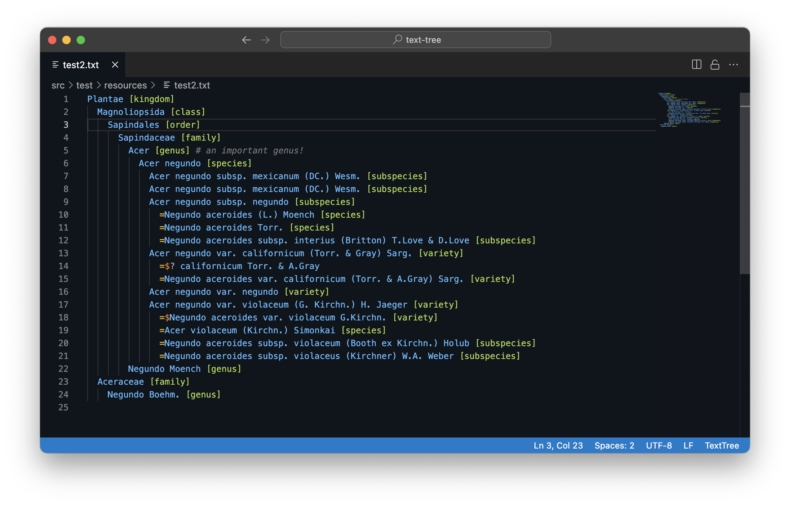

# TextTree format

TextTree is a simple format to represent taxonomic trees using indented, plain text.
It is recommended to use the file extension `.txt` or `.txtree`.

Each row in a TextTree represent a scientific name. 
Each name can include the authorship and should be given a rank following the name in angular brackets:

```
Abies alba Mill. [species]
```

All rank names are case insensitive, 
but must follow the [rank enumeration](https://github.com/gbif/name-parser/blob/master/name-parser-api/src/main/java/org/gbif/nameparser/api/Rank.java#L32) provided by the GBIF Name Parser.

The indentation level (strictly 2 spaces) and its upper rows
represent the classification:
```
Pinales [order]
  Pinaceae Spreng. [family]
    Abies [genus]
      Abies alba Mill. [species]
      Abies balsamea (L.) Mill. [species]
```

Synonyms are represented as direct, nested children that are prefixed by a `=` or `≡` 
if they are homotypic to the name directly above.
```
Pinales [order]
  Pinaceae Spreng. [family]
    Abies [genus]
      Abies alba Mill. [species]
        =Pinus picea L.
      Abies balsamea (L.) Mill. [species]
        ≡$Pinus balsamea L.
```
 
Basionyms can also be marked by prefixing the name with an additional `$` dollar symbol as in the `Pinus balsamea` example above.

This allows for rather rich synonymies being expressed:
```
Agoseris apargioides (Less.) Greene [species]
  ≡$Troximon apargioides Less. [species]
  ≡Barkhausia lessingii Hook. & Arn. [species]
  ≡Stylopappus lessingii D.Dietr. [species]
  =Macrorhynchus humilis Benth. [species]
  ≡Troximon humilis (Benth.) A.Gray [species]
  ≡Agoseris humilis (Benth.) Kuntze [species]
  =Agoseris maritima E.Sheld. [species]
  ≡Agoseris apargioides subsp. maritima (E.Sheld.) Q.Jones [subspecies]
  ≡Agoseris apargioides var. maritima (E.Sheld.) G.I.Baird [variety]
  =Agoseris maritima Eastw. [species]
  ≡Agoseris eastwoodiae Fedde [species]
  ≡Agoseris apargioides var. eastwoodiae (Fedde) Munz [variety]
```

Provisional names, e.g. with uncertain placement or lacking scrutiny, 
can be prefixed with a `?` to distinguish them from properly accepted names:
```
Agoseris Raf. [genus]
  Agoseris apargioides (Less.) Greene [species]
  ?Troximon humilis (Benth.) A.Gray [species]
```

The common convention to prefix extinct taxa with a dagger symbol is also supported:
```
Reptilia [class]
  †Bolosauria [order]
  Crocodylia [order]
    †Crocodylus megarhinus Andrews, 1905 [species]
      =†Crocodylus articeps Andrews, 1906 [species]
  †Dinosauria [order]
``` 

Additional semi structured information can be given as key value pairs in curly brackets. 
Keys must be all upper case and are delimited with the value by the equality sign. Multiple values can be delimited by a comma.
Values should therefore not contain the reserved character ','. If needed they can be escaped by doubling them, i.e. `,,` should be used to represent a comma in the value and `,,,,` for 2 commas.

```
  Abies alba Mill. [genus] {ID=1234 PUB=Miller2019 ENV=terrestrial,marine REF=Döring2021,Banki2022 VERN=de:Traubeneiche,fr:Chêne rouvre,dk:Vintereg,nl:Wintereik}
```

Comments can be given after each name or the dynamic info starting with a `#` symbol:
```
Pinales [order]
  Pinaceae Spreng. [family]
    Abies [genus]
      Abies alba Mill. [species]
        =Pinus picea L. [species]
      Abies balsamea (L.) Mill. [species] {PUB=Miller2019}  # need to verify the reference
        =$Pinus balsamea L. [species]   # this is the basionym of A. balsamea 
```

## ChecklistBank guide
[ChecklistBank](https://www.checklistbank.org) provides a small [publishing guide](https://catalogueoflife.github.io/coldp/docs/publishing-guide-txtree) for TextTree based datasets which defines a small set of info keys and a way to share structured references.


## Java packages

Two artifacts are published.

### `org.gbif:text-tree`

Reads and writes the format. **No runtime dependencies**, Java 17 or newer.

```xml
<dependency>
  <groupId>org.gbif</groupId>
  <artifactId>text-tree</artifactId>
  <version>2.0.0</version>
</dependency>
```

```java
Tree<SimpleTreeNode> tree = Tree.simple(in);   // rank and name kept as given, as strings
Tree.VerificationResult result = Tree.verify(in);
```

`Tree.parse(reader, listener, factory)` builds a tree of any node type you like — supply a
`TreeNodeFactory` and it is handed a `TreeNodeData` for each line.

### `org.gbif:text-tree-parsed`

Adds `ParsedTree`, which runs every name through the
[GBIF Name Parser](https://github.com/gbif/name-parser) and gives each node a `ParsedName`
alongside the verbatim string.

```xml
<dependency>
  <groupId>org.gbif</groupId>
  <artifactId>text-tree-parsed</artifactId>
  <version>2.0.0</version>
</dependency>
```

You supply the parser. text-tree depends on `name-parser-api` only, never on an implementation —
the current one, [`name-parser-rust`](https://github.com/gbif/name-parser-rust), needs JDK 22+ and
a per-platform native jar, which text-tree does not force on anyone who is only reading trees:

```java
Tree<ParsedTreeNode> tree = ParsedTree.parse(in, new NameParserRust());

for (ParsedTreeNode n : tree) {
  n.result;      // ParseResult: Parsed | Informal | Unparsable, never null
  n.parsedName;  // ParsedName, null only for Unparsable results
  n.code;        // NomCode in scope, or null if the tree declares none
}
```

The `CODE` info key sets the nomenclatural code for a name and is **inherited by its descendants**,
as ChecklistBank does it. Declare it once near the root:

```
Plantae [kingdom] {CODE=botany}
  Bryophyta [division]        # resolves to division_botany
```

It does two things: it disambiguates the ranks that exist once per code — `division`, plus
`section` and `series` with their sub/super forms — and it is passed to the name parser, which uses
it. (`subdivision` and `superdivision` are single ranks and need no code.) Values may
be a `NomCode` name (`botanical`), its acronym (`ICN`, `ICZN`) or a common word (`botany`, `plants`,
`zoology`). `ICPN` is not accepted: `PHYTO` and `PHYLO` both claim it. An unrecognised value is
ignored and the inherited code stands.

To wire the Rust binding, add the `os-maven-plugin` build extension so the native classifier jar
resolves for your platform:

```xml
<build>
  <extensions>
    <extension>
      <groupId>kr.motd.maven</groupId>
      <artifactId>os-maven-plugin</artifactId>
      <version>1.7.1</version>
    </extension>
  </extensions>
</build>

<dependency>
  <groupId>org.gbif.nameparser</groupId>
  <artifactId>name-parser-rust</artifactId>
  <version>0.1.0</version>
</dependency>
<dependency>
  <groupId>org.gbif.nameparser</groupId>
  <artifactId>name-parser-rust</artifactId>
  <version>0.1.0</version>
  <classifier>${os.detected.classifier}</classifier>
</dependency>
```

Run with `--enable-native-access=ALL-UNNAMED` to silence the JDK's restricted-method warning.

When parsing badly formatted trees the parser on purpose fails and does not try to read the
remaining bits.

## Upgrading from 1.x

- `Tree.simple(..)`, `Tree.verify(..)` and printing are unchanged. If that is all you use, bump the
  version and delete any `org.gbif:name-parser` exclusion you had on text-tree.
- `Tree.parsed(in)` becomes `ParsedTree.parse(in, parser)` in the new `text-tree-parsed` artifact,
  and `org.gbif.txtree.ParsedTreeNode` moves to `org.gbif.txtree.parsed.ParsedTreeNode`.
- A bare `[division]` now needs a nomenclatural code in scope, because `name-parser-api` 5.0.0
  split `Rank.DIVISION` into `DIVISION_BOTANY` and `DIVISION_ZOOLOGY`. Either declare a
  `{CODE=botany}` on the name or an ancestor, or write the rank out as `[division botany]` /
  `[division zoology]`. `[section]`, `[series]` and their sub/super forms already behaved this way,
  and now resolve from `CODE` too.
- A rank resolved from a code re-prints in its resolved form: `[division]` under `{CODE=botany}`
  comes back out as `[division_botany]`. The disambiguation is information the tree did not carry
  before.
- A line containing only whitespace is now skipped rather than failing the parse.


## Visual Studio Code Extension
We provide an extension for VS Code to do syntax highlighting.
It is available in the [VSCode Marketplace](https://marketplace.visualstudio.com/items?itemName=GBIF.texttree).
To install simply search the marketplace for the extension `TextTree`.

When installed files with the a file suffix `.txtree` and `.tree` should automatically make use of it.
Please make sure to also switch your color theme in your settings to the bundled `TextTree` theme.





## Sublime syntax highlighting
We also provide a [TextTree sublime package](https://github.com/gbif/text-tree-sublime) that defines the syntax highlighting for the [Sublime Text](https://www.sublimetext.com) editor.
To use it simply install it via the default [Package Control](https://packagecontrol.io/docs/usage) repository.


